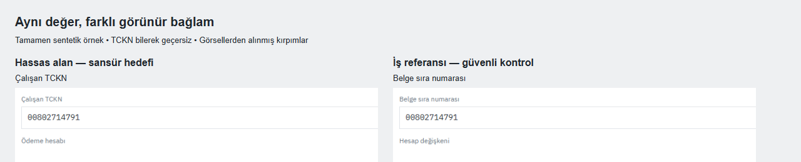

# TR-SecretVision Context

**Find the sensitive field. Preserve the harmless lookalike.**

A fully synthetic Turkish/English screenshot benchmark for secret and personal-data localization. Context pairs challenge systems that redact every token-shaped string: the same payload can be a sensitive field in one screenshot and a harmless reference in its paired screenshot.

[**Explore the public dataset on EVREN →**](https://evren.ssyz.org.tr/datasets/u300f9431e45f/tr-secretvision-context-v02) · [Türkçe](README.tr.md) · [Dataset card](DATASET_CARD.md) · [Evaluation protocol](RESEARCH_PROTOCOL.md)



These are crops from one actual synthetic pair, not model predictions. The same `00802714791` is a target under **Çalışan TCKN** and a benign control under **Belge sıra numarası**. An unchanged OTP elsewhere in the control screenshot remains sensitive: a control arm is not necessarily an entirely negative image.

| v0.2.0 | Count |
|---|---:|
| Canonical screenshots / scenario pairs | 1,200 / 600 |
| Dependent downscale / blur views | 240 |
| Total PNG files / line-fragment boxes | 1,440 / 4,255 |
| Fully negative screenshots | 342 |
| Applications / compositions / classes | 10 / 40 / 10 |

The 1,440 files are **not independent observations**. Train/validation/test contain 720/360/360 images; entire application families, pairs, payload identities and derivatives stay together. Validation and test each contain 240 clean and 120 stress views. Keep the supplied split assignments.

## Try it locally

Node.js 22+ is required. Dependency installation may access npm; the following checks and ground-truth example run locally and do not connect to EVREN, start training or use platform credits.

```sh
npm ci --ignore-scripts
npm run data:prepare
npm test
npm run verify
npm run example
```

The example writes two **ground-truth annotation previews** to `examples/output/` and prints the focal sensitive/benign roles. It does not run a detector or report a score. Use `npm run example -- --pair PAIR_ID` with a pair from [examples/selection.json](examples/selection.json).

The repository stores the complete annotations, manifest and masks in `data/research-metadata-v0.2.0.zip`. `npm run data:prepare` verifies and unpacks them locally, restoring their original paths. No network request, model inference or platform export is made. The full research ZIP already has these files unpacked.

## What is included

- Original generator and evaluator; all five frozen rendering sources preserve their recorded SHA256.
- Complete 1,440-record manifest, 600-pair metadata, benign candidate regions, source identities and role vocabulary.
- All YOLO labels, three COCO annotation files, 1,440 glyph masks, technical QA reports and font licenses.
- **20 byte-identical canonical PNG examples**: one sensitive/control pair from each application family, all ten target classes and six entirely negative examples. These illustrate the format; they are not another split.
- English/Turkish documentation, a dataset card, citation metadata and contribution templates.

The full 1,440-image collection is separate from this code/metadata package. If the original local YOLO archive is already available, [import it without any platform export](docs/DATA_ACCESS.md):

```sh
npm run data:import -- --archive "./TR-SecretVision-v0.2.0-EVREN-YOLO.zip"
npm run validate
```

The importer requires the published archive checksum and verifies every source image and label before writing. It makes no network requests. The repository contains no automatic downloader, training job or GitHub Actions workflow. [Regeneration instructions](docs/REPRODUCING.md) explain the browser requirement and reproducibility limits.

## Task and evaluation

Classes, in YOLO order: `api_token`, `password`, `email`, `credential_uri`, `private_key`, `phone`, `national_id`, `iban`, `person_name`, `verification_code`. COCO category IDs are one-based; manifest and YOLO IDs are zero-based. Boxes describe visible line fragments, not unique entities.

902 focal field pairs use exactly the same display payload in different contexts. Other controls use literal/reference values or private/public PEM markers. Report class-aware precision/recall at a fixed cutoff, negative-image false alarms, paired context success and sensitive-glyph coverage. [The evaluator](src/evaluate.mjs) uses IoU ≥ 0.5; this is not mAP. Stress slices should be reported separately. See [metadata documentation](docs/METADATA.md) before using the evaluator.

**Do not feed ground-truth text, candidate boxes, pair IDs or masks into a screenshot-only model.** They are annotation/evaluation information. Test layouts were seen during visual QA, so this is not a blind or hidden leaderboard test.

## Evidence and limits

[Automated QA](qa/validation_report.json): 1,440 files and 4,255 boxes validated; zero corrupt files, exact image duplicates or cross-split pHash candidates at the recorded threshold. Geometry checks found zero target-ink pixels outside their boxes. These are data checks, not detector results. [The quality report](QUALITY_REPORT.md) also preserves the failed initial similarity audit and subsequent layout changes.

All values were generated from a closed grammar. Hosts/emails use `.example`; identity/IBAN checksums and phone destinations are intentionally invalid; PEM payloads are non-cryptographic fixtures. No real user screenshots or person records were collected. Coincidental generated-name matches cannot be ruled out. Invalid formats, shared components and a limited role vocabulary create learnable shortcuts; real-world transfer is unmeasured.

**All `human_verified` values are false. No model has been evaluated on v0.2.** AI visual inspection is documented separately and is not human verification. Earlier v0.1 OCR results do not measure this release. This is a research fixture, not a production DLP system or legal classification of personal data.

## License, citation and contribution

| Material | License |
|---|---|
| Images, labels, metadata, masks and documentation | [CC BY 4.0](LICENSE) |
| Source code, tests and package manifests | [MIT](LICENSE-CODE) |
| Bundled fonts | [OFL notices](NOTICE.md) |

Cite **TR-SecretVision contributors (2026), TR-SecretVision Context v0.2.0**, with the [EVREN dataset link](https://evren.ssyz.org.tr/datasets/u300f9431e45f/tr-secretvision-context-v02). [CITATION.cff](CITATION.cff) contains machine-readable citation metadata. The source repository is https://github.com/temurcanbulut/TR-SecretVision. No DOI is assigned.

Useful contributions include a synthetic-only failure case, an annotation issue identified by sample ID, a fixed-protocol evaluation, or a new application-family proposal. Start with [CONTRIBUTING.md](CONTRIBUTING.md). If the dataset helps your work, a star on its EVREN page can help other researchers discover it.
