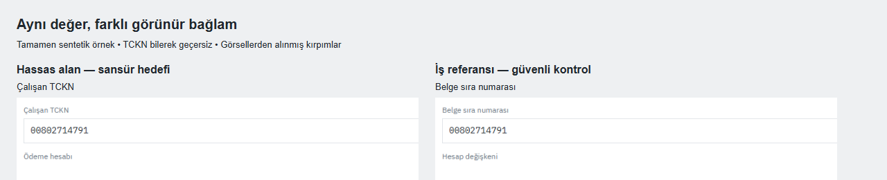

# TR-SecretVision Context

**Hassas alanı bul, benzer görünen güvenli değeri koru.**

Türkçe/İngilizce geliştirici ekranlarında sır ve kişisel veri yerelleştirmesi için tamamen sentetik araştırma veri seti. Aynı dizgenin farklı görünür rollerde hassas veya güvenli sayıldığı karşıt çiftler, yalnızca dizge biçimine dayanan sansürün sınırlarını incelemeyi sağlar.

[**EVREN'deki herkese açık veri seti →**](https://evren.ssyz.org.tr/datasets/u300f9431e45f/tr-secretvision-context-v02) · [English](README.md) · [Veri kartı](DATASET_CARD.md)



Bu görsel özgün sentetik ekranların açıklamalı kırpımıdır; model tahmini değildir. Bilerek geçersiz `00802714791` sayısı **Çalışan TCKN** rolünde hedef, **Belge sıra numarası** rolünde güvenli kontroldür. Kontrol ekranındaki değişmeyen OTP hâlâ hassastır; kontrol kolu her zaman tamamen negatif değildir.

v0.2.0: **1.200 temel ekran, 600 senaryo çifti, 240 ilişkili stres türevi, 4.255 satır kutusu, 342 tamamen negatif ekran, 10 sınıf ve 10 uygulama ailesi**. Toplam 1.440 dosya bağımsız gözlem değildir. Eğitim/doğrulama/test: 720/360/360. Uygulama ailesi, çift, kimlik ve türevler aynı bölümde kalır; otomatik yeniden bölümleme kullanmayın.

## Yerelde dene

Node.js 22+ gerekir. `npm ci` bağımlılıkları indirmek için npm ağına erişebilir; aşağıdaki örnek ve kontroller EVREN'e bağlanmaz, model çalıştırmaz veya eğitmez, platform kredisi harcamaz.

```sh
npm ci --ignore-scripts
npm run data:prepare
npm test
npm run verify
npm run example
```

Son komut `examples/output/` altında bir çiftin gerçek etiket kutularını gösterir. Çıktı **ground truth** görselleştirmesidir; model başarısı değildir. [Örnek seçimi](examples/selection.json) her uygulamadan bir çift içerir: 20 değişmemiş PNG, 10 sınıf ve 6 tamamen negatif örnek. Yeni bir eğitim/test bölümü oluşturmaz.

Depoda tam etiketler, manifest ve maskeler `data/research-metadata-v0.2.0.zip` içinde saklanır. `npm run data:prepare` dosya özetlerini doğrulayıp bunları özgün yollarına yerelde açar. Ağ isteği, model çalıştırma veya platform dışa aktarımı yapmaz. Tam araştırma ZIP’inde bu dosyalar zaten açıktır.

## Paket içeriği

Üretim ve değerlendirme kodu; 1.440 kaydın tam manifesti; 600 çiftin ilişkileri; hassas/güvenli aday bölgeleri; YOLO ve COCO etiketleri; 1.440 glif maskesi; otomatik kalite raporları; lisanslar, fontlar ve kullanım belgeleri. Beş dondurulmuş üretim kaynağının dosya özetleri korunur.

1.440 görselin tamamı bu kod/metaveri paketine konmadı. Daha önce hazırlanmış yerel özgün YOLO ZIP'i elinizdeyse [yerel içe aktarıcı](docs/DATA_ACCESS.md) dosya özetlerini kontrol ederek kullanır:

```sh
npm run data:import -- --archive "./TR-SecretVision-v0.2.0-EVREN-YOLO.zip"
npm run validate
```

İçe aktarıcı indirme veya platform dışa aktarımı yapmaz. Yeniden üretim ve tarayıcı gereksinimi [burada](docs/REPRODUCING.md). Otomatik eğitim, indirme veya GitHub Actions iş akışı yoktur.

## Nasıl değerlendirilmeli?

Sınıflar: API belirteci, parola, e-posta, kimlik bilgili bağlantı, özel anahtar materyali, telefon, TCKN, IBAN, kişi adı ve doğrulama kodu. YOLO/metaveri sınıfları 0'dan, COCO kategorileri 1'den başlar. Satır kutusu sayısı tekil kişi/sır sayısı değildir.

902 odak alan çiftinde görünen değer aynıdır. Diğer çiftler açık değer/değişken referansı veya özel/açık PEM işaretçisini karşılaştırır. Yalnız recall yerine sabit eşikte precision/recall, negatif yanlış alarm, karşıt çift başarısı ve glif kaplama raporlanmalıdır. IoU≥0,5 skorlayıcısı mAP hesaplamaz. [Araştırma protokolü](RESEARCH_PROTOCOL.md) ve [metaveri açıklaması](docs/METADATA.md) giriş sınırlarını tanımlar. Etiket metni, kutu, çift kimliği ve maskeleri modele girdi vermek değerlendirmeyi bozar.

## Kalite ve sınırlar

[Otomatik QA](qa/validation_report.json) PASS: bozuk dosya, birebir yinelenen görsel ve kayıtlı pHash eşiğinde bölümler arası aday 0. Kutuların dışında hedef glif pikseli 0. Bu sonuçlar veri geometrisi/ayrım kontrolleridir, model başarısı değildir.

**Bütün `human_verified` alanları false. v0.2 üzerinde model başarımı ölçülmedi.** AI görsel örnek incelemesi insan doğrulaması değildir. Eski v0.1 OCR sonucu bu sürüme taşınmaz. Test düzenleri QA sırasında görüldü; kör test iddiası yoktur.

Gerçek ekran veya kişi kaydı toplanmadı. `.example` alanları, geçersiz TCKN/IBAN/telefon ve kriptografik olmayan PEM fikstürleri kullanıldı. Rastlantısal isim benzerliği dışlanamaz. Kapalı gramer, ortak bileşenler ve geçersiz biçimler öğrenilebilir kestirmeler oluşturur; gerçek dünya aktarımı ölçülmedi. Bu bir üretim DLP sistemi veya hukuki KVKK sınıflandırması değildir.

Veri/etiket/metaveri/belge [CC BY 4.0](LICENSE); kod [MIT](LICENSE-CODE); fontlar [OFL](NOTICE.md). Atıf: **TR-SecretVision contributors (2026), TR-SecretVision Context v0.2.0**, [EVREN bağlantısı](https://evren.ssyz.org.tr/datasets/u300f9431e45f/tr-secretvision-context-v02). Kaynak depo: https://github.com/temurcanbulut/TR-SecretVision. Henüz DOI atanmamıştır. [Katkı rehberi](CONTRIBUTING.md) sentetik hata örnekleri ve yeniden üretilebilir araştırma katkıları içindir. Faydalı bulursanız EVREN sayfasındaki yıldız keşfedilmesine yardımcı olabilir.

[2026-11 source-review follow-up and exact limitations](docs/AUDIT_FOLLOWUP.md).

## Gerçek görüntü OCR başlangıç sonuçları

240 temiz test PNG'sinde kurulu Windows OCR (tr) + sabit kurallar: değer kuralları
precision **%25,93**, recall **%26,88**; görünür alan rolü kuralları precision
**%97,26**, recall **%20,97**. Tam karşıt çift başarısı sırasıyla **%0 / %5,83**.
Bağlam filtresi yanlış alarmı azaltır; çoğu hassas alan hâlâ kaçırılır. Bunlar
yayından sonra yazılmış tanılayıcılardır, kör deney veya üretim güvenliği iddiası
değildir. [Ham OCR, kod, kapsam ve yeniden oynatma](docs/FULL_IMAGE_OCR.md).
